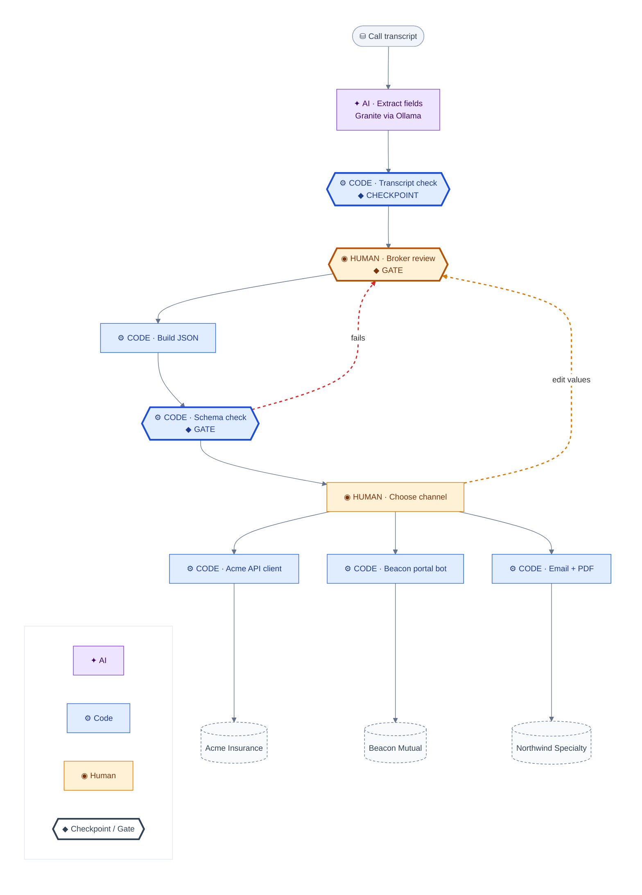

# Lead Intake Demo

An AI extracts a commercial insurance intake form from a sales call transcript, but it never gets the final say. Every value is either proven against the transcript by code or approved by a broker, and the result must pass a JSON Schema before it can reach a carrier.

## Pipeline



AI touches the data once, at the start. Everything after it is code proving something or a human deciding.

## Pipeline validation

The model's output is treated as a claim, not an answer. A **checkpoint** flags what code can't prove; a **gate** stops anything moving on until it passes.

| Step | Who | Type | What it does |
| --- | --- | --- | --- |
| Extract fields | AI | | Pulls each field's value and the exact quote it came from. Never trusted on its own |
| Transcript check | Code | Checkpoint | Quote exists in the transcript, value appears in the quote, valid format, no conflicting mentions |
| Broker review | Human | Gate | Approves, edits or fills every field before anything is built |
| Schema check | Code | Gate | Every field present with the right type and format before anything reaches a carrier |

Code proves a value wasn't invented. The broker confirms it's right. The schema guarantees every carrier gets the same well-formed record.

## Install and run

Requires Ruby 4.0, Rails 8 and [Ollama](https://ollama.com) with `granite4.2:8b`. Ollama is optional: without it, the sample transcripts use built-in fixture extractions.

```sh
./install.sh     # one-time setup on a new Mac
./run.sh         # starts Ollama and the app at http://localhost:3000
bin/rails test   # offline; never calls Ollama
```

## Examples

Three sample transcripts are preloaded on the start page.

| Sample | What happens in review | Acme API | Beacon bot | Northwind email |
| --- | --- | --- | --- | --- |
| **Northgate Dental** (happy path) | Everything verifies except years in business | Quoted, $23,800 | Quoted, $23,800 | Sent |
| **Hudson Millwork** (AI caught) | Eight fields go to the broker: FEIN spoken as words, NAICS never given, revenue in words, headcount corrected mid-call, a second location's ZIP, "first of April next year", a spelled-out email, years in business | Referred (revenue over $5M) | Referred | Sent |
| **Lumen Analytics** (channels differ) | ZIP+4 fails the format check until the broker fixes it | Quoted, $8,700 | Failed: no cyber option on the portal | Sent |
